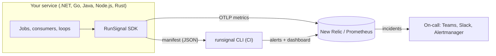

# RunSignal

**Cross-language workload observability and alert provisioning.**

Your APM alerts on HTTP 500s and slow endpoints. The failures that hurt most often happen where there is no
HTTP request at all:

- The 02:00 invoice job never started, because the server restarted or the scheduler got stuck.
- A queue consumer is up but has not processed a message for 20 minutes.
- The bank statement file did not arrive, so the import "succeeded" with 0 rows.
- A background loop is deadlocked, and its exception was swallowed in a `catch`.

RunSignal records the **runs, items and heartbeats** of background work as OpenTelemetry metrics, with the same
names in .NET, Go, Java, Node.js and Rust. From a manifest of what each job is expected to do, it **provisions
the alerts and dashboards** in your observability backend: missed, failed, overrun, stalled, low output and
failure rate.

> **Status: 0.1.** Everything below works and is tested, including end to end against a live New Relic account
> and a local Prometheus. Until 1.0, minor versions may contain breaking changes. Teams and Slack routing is
> implemented but not yet verified end to end. See the [roadmap](docs/ROADMAP.md) and the
> [changelog](CHANGELOG.md).

## Installation

| Language | Package | Install |
|---|---|---|
| .NET | [`RunSignal.DotNet`](https://www.nuget.org/packages/RunSignal.DotNet) and integrations | `dotnet add package RunSignal.DotNet` |
| Go | [`github.com/gokhanertogan/RunSignal/go`](https://pkg.go.dev/github.com/gokhanertogan/RunSignal/go) | `go get github.com/gokhanertogan/RunSignal/go` |
| Java | [`io.github.gokhanertogan.runsignal`](https://central.sonatype.com/namespace/io.github.gokhanertogan.runsignal) | `runsignal-spring-boot-starter` or `runsignal`, version `0.1.0` |
| Node.js | [`@runsignal/node`](https://www.npmjs.com/package/@runsignal/node) | `npm install @runsignal/node @opentelemetry/api` |
| Rust | [`runsignal`](https://crates.io/crates/runsignal) | `cargo add runsignal` |
| CLI | [`RunSignal.Cli`](https://www.nuget.org/packages/RunSignal.Cli) | `dotnet tool install -g RunSignal.Cli` |

## Contents

- [Installation](#installation)
- [How it works](#how-it-works)
- [Concepts](#concepts)
- [Quick start](#quick-start)
- [Integrations](#integrations)
- [Alerts](#alerts)
- [Backends](#backends): [New Relic](#new-relic), [Prometheus and Grafana](#prometheus-and-grafana)
- [CLI](#cli)
- [Signals and specification](#signals-and-specification)
- [Performance](#performance)
- [Repository layout](#repository-layout)
- [Building and testing](#building-and-testing)

## How it works



1. **Record.** The SDK records each run of a workload (success, failure, cancellation, duration), the items
   it handled, and heartbeats from long-running loops. Integrations do this with no code for Hangfire, Quartz.NET,
   Spring `@Scheduled`, Spring Batch, BullMQ and robfig/cron.
2. **Describe.** Each workload declares what it is expected to do: its cron schedule, maximum duration,
   heartbeat interval, minimum output and acceptable failure rate. The running application writes these to a
   [manifest](spec/manifest.schema.json).
3. **Provision.** In CI, `runsignal provision` turns the manifest into alert conditions and a dashboard in New
   Relic, or `runsignal export prometheus` writes Prometheus alerting rules.

Alerts are evaluated by the backend, never in your process, because a process that has died cannot report
that it is missing.

## Concepts

| Term | Meaning |
|---|---|
| **Workload** | A unit of background work with a stable name, such as `nightly-invoice`: a scheduled job, a consumer, a sync loop. |
| **Run** | One execution of a workload. It ends as `success`, `failure` (with an `error.type`) or `cancelled`. |
| **Item** | One unit of work inside a run, such as an invoice or a message: `processed` or `failed`. |
| **Heartbeat** | A periodic "alive and making progress" mark from a long-running loop. |
| **Expectations** | What the workload should do. Each one produces an alert: |

| Expectation | Example | Alert |
|---|---|---|
| `schedule` | `0 2 * * *` | **missed**: no success within the schedule plus grace; **failed**: a run failed |
| `maxDuration` | 30 minutes | **overrun**: a run took longer |
| `expectEvery` | 5 minutes | **stalled**: no heartbeat in time |
| `minProcessed` | 100 | **low output**: runs processed fewer items |
| `failureRateThreshold` | 0.2 | **failure rate**: too many failed runs or items |
| `severity` | `critical` | routes the alerts (for example, critical pages on-call) |

## Quick start

Every SDK follows the same three steps. The examples declare a nightly job that must succeed every day,
finish within 30 minutes and process at least 100 invoices.

**1. Record the work.**

<details open>
<summary>.NET</summary>

```csharp
builder.Services.AddRunSignal()
    .AddWorkload("nightly-invoice", o =>
    {
        o.Schedule = "0 2 * * *";
        o.MaxDuration = TimeSpan.FromMinutes(30);
        o.MinProcessed = 100;
        o.Severity = Severity.Critical;
    });
builder.Services.AddOpenTelemetry().WithMetrics(m => m.AddRunSignalInstrumentation().AddOtlpExporter());

// In the job ([FromKeyedServices("nightly-invoice")] Workload workload):
await workload.RunAsync(async ct =>
{
    foreach (var order in await orders.GetUnbilledAsync(ct))
    {
        await invoices.CreateAsync(order, ct);
        workload.Processed();
    }
}, ct);
```

More: [docs/dotnet.md](docs/dotnet.md)
</details>

<details>
<summary>Go</summary>

```go
invoices := runsignal.Default.MustWorkload("nightly-invoice",
    runsignal.Schedule("0 2 * * *"), runsignal.MaxDuration(30*time.Minute),
    runsignal.MinProcessed(100), runsignal.WithSeverity(runsignal.Critical))

err := invoices.Run(ctx, func(ctx context.Context) error {
    for _, order := range orders {
        if err := createInvoice(ctx, order); err != nil {
            return err
        }
        invoices.Processed(ctx, 1)
    }
    return nil
})
```

More: [go/](go)
</details>

<details>
<summary>Java (Spring Boot)</summary>

```java
@Scheduled(cron = "0 0 2 * * *")
@RunSignal(value = "nightly-invoice", maxDuration = "30m", minProcessed = 100, severity = Severity.CRITICAL)
void generateInvoices() {
    // recorded automatically by runsignal-spring-boot-starter
}
```

More: [src/RunSignal.Java](src/RunSignal.Java)
</details>

<details>
<summary>Node.js</summary>

```ts
const invoices = defaultRegistry.workload('nightly-invoice', {
  schedule: '0 2 * * *', maxDuration: '30m', minProcessed: 100, severity: 'critical',
});

await invoices.run(async () => {
  for (const order of await unbilledOrders()) {
    await createInvoice(order);
    invoices.processed();
  }
});
```

More: [src/RunSignal.Node](src/RunSignal.Node)
</details>

<details>
<summary>Rust</summary>

```rust
let invoices = Registry::global().workload("nightly-invoice", Options::new()
    .schedule("0 2 * * *")
    .max_duration(Duration::from_secs(30 * 60))
    .min_processed(100)
    .severity(Severity::Critical))?;

invoices.run_async(async {
    for order in unbilled_orders().await? {
        create_invoice(&order).await?;
        invoices.processed(1);
    }
    Ok::<_, anyhow::Error>(())
}).await?;
```

More: [src/RunSignal.Rust](src/RunSignal.Rust)
</details>

**2. Export to your backend** over OTLP. For New Relic use **delta temporality**: with cumulative, a stopped
workload never looks stopped. Prometheus works with the default (cumulative).

**3. Provision alerts from CI.**

```bash
RUNSIGNAL_MANIFEST_PATH=runsignal.json <start your app>   # writes the manifest (see below)
export NEW_RELIC_API_KEY=NRAK-...                          # a New Relic User API key
runsignal provision runsignal.json --account-id 1234567 --region EU
```

.NET and the Spring Boot starter write the manifest by themselves once the application has started. In Go,
Node.js and Rust, call `WriteManifestFromEnv` / `writeManifestFromEnv` / `write_manifest_from_env` once your
workloads are registered.

## Integrations

| Language | Monitored with no code in the jobs | Also |
|---|---|---|
| .NET | Hangfire 1.8+, Quartz.NET 3 and 4 | `BackgroundService` heartbeats, keyed DI |
| Java | Spring `@Scheduled`, Spring Batch 5 and 6 (Spring Boot 3.2+ and 4) | expectations in `application.yml` |
| Go | robfig/cron | `context` cancellation, panic handling |
| Node.js | BullMQ processors and job schedulers | `AbortSignal` cancellation |
| Rust | | sync and async runs; a dropped future is a cancelled run |

Scheduler integrations also register jobs as workloads **at startup**, with their cron schedules, so a job
that never fires still gets a `missed` alert.

## Alerts

| Alert | Fires when | New Relic | Prometheus |
|---|---|---|---|
| `missed` | No success for longer than the longest gap in the schedule plus grace (`maxDuration`, or 15 minutes) | ✅ | ✅ |
| `failed` | A run failed (scheduled workloads without a failure-rate threshold) | ✅ | ✅ |
| `stalled` | No heartbeat for longer than `expectEvery` | ✅ | ✅ |
| `overrun` | A run took longer than `maxDuration` | ✅ | ✅ (rounded up to a histogram bucket) |
| `low output` | Successful runs processed fewer than `minProcessed` items on average within an hour | ✅ | ✅ |
| `failure rate` / `item failure rate` | More than `failureRateThreshold` of runs / items failed within 15 minutes | ✅ | ✅ |
| `not reporting` | The service sent nothing for 15 minutes (it is down, or never started) | as loss of signal on `missed` / `stalled` | `RunSignalNotReporting` |

Every alert kind has fired on a live New Relic account, and every Prometheus rule is covered by
`promtool test rules`.

## Backends

### New Relic

1. **Export** over OTLP to `https://otlp.eu01.nr-data.net:4317` (US: `otlp.nr-data.net`) with an ingest
   (license) key in the `api-key` header, and **delta temporality**
   (`OTEL_EXPORTER_OTLP_METRICS_TEMPORALITY_PREFERENCE=delta`).
2. **Provision.** `runsignal provision` creates the following, and running it again changes only what changed:
   - One policy per service and severity (`RunSignal: billing-service (critical)`) with its NRQL conditions.
   - A workflow per policy, routing incidents to the notification channels you pass with `--channel critical=<channel-id>`. Create the Teams or Slack destination and channel in New Relic first; Slack destinations can only be created in the UI.
   - A dashboard, `RunSignal: billing-service`, showing runs by outcome, time since each workload's last success and heartbeat, p95 duration, items processed, and failures by error type.
3. **Ownership.** RunSignal changes and deletes only what it created. Conditions added by hand, and the
   policies that hold them, are kept. Notification channels are never deleted.

To check that every alert reaches you before a real job fails, run the
[alert drill](samples/RunSignal.Samples.AlertDrill). It breaks one expectation per workload. On New Relic,
overrun and stalled open within about 5 minutes, the failure rates within about 30 minutes, and low output once
its hour closes.

### Prometheus and Grafana

Prometheus 3 receives OTLP directly (`--web.enable-otlp-receiver`, endpoint `/api/v1/otlp/v1/metrics`). Generate
rules from the same manifests, then load them into Prometheus, Grafana Mimir or any Prometheus-compatible
ruler:

```bash
runsignal export prometheus billing.json payments.json -o runsignal-rules.yml
```

- **Routing:** Alertmanager routes on the `severity` and `runsignal_alert` labels.
- **Metric names:** the rules use the names Prometheus gives OTLP metrics by default (`runsignal_workload_runs_total`; `job` is `service.name`).
- **Thresholds:** the same as for New Relic; both backends share `RunSignal.Alerting`.

## CLI

`runsignal` is a .NET tool (`src/RunSignal.Cli`). It reads manifests from any SDK.

| Command | What it does |
|---|---|
| `plan <manifests>` | Shows the alert conditions, offline. |
| `diff <manifests> --account-id <id> [--region EU]` | Shows what `provision` would change in New Relic. |
| `provision <manifests> --account-id <id> [--channel critical=<id>] [--no-dashboard]` | Creates and updates policies, conditions, workflows and the dashboard. |
| `destroy --service <name> --account-id <id> [--dry-run]` | Removes what RunSignal created for a service. |
| `export prometheus <manifests> [-o rules.yml]` | Writes Prometheus alerting rules. |

Common options:
- `--time-zone Europe/Istanbul` sets the time zone schedules run in (default UTC).
- `--missed-grace` and `--not-reporting-after` set the grace periods, in minutes.
- `NEW_RELIC_API_KEY` holds the User API key.

Expected errors print one line and exit with code 1.

## Signals and specification

Every SDK emits the same instruments on the meter `RunSignal`:

| Metric | Type | Attributes |
|---|---|---|
| `runsignal.workload.runs` | counter | `runsignal.workload`, `runsignal.outcome`, `error.type` (failures) |
| `runsignal.workload.duration` | histogram (s, buckets from 10 ms to 8 h) | `runsignal.workload`, `runsignal.outcome` |
| `runsignal.workload.items` | counter | `runsignal.workload`, `runsignal.item.result` |
| `runsignal.workload.heartbeats` | counter | `runsignal.workload` |
| `runsignal.workload.since_success` | gauge (s) | `runsignal.workload` |
| `runsignal.workload.since_heartbeat` | gauge (s) | `runsignal.workload` |

The `since_*` gauges count from registration until the first success or heartbeat. A job that never runs
therefore still looks overdue, which matters because backends only notice that a signal stopped if it was seen
at least once. Runs are also recorded as spans.

The contract is in [spec/README.md](spec/README.md). The SDKs are held to it by the shared
[conformance vectors](spec/conformance), which every SDK's test suite runs:
- workload naming, including non-ASCII names (`e-Arşiv gönderimi` becomes `e-arsiv-gonderimi`);
- a scenario whose exact metrics (names, types, units, attributes, values and histogram bounds) every SDK must reproduce;
- a byte-for-byte identical manifest.

## Performance

Recording a run, an item or a heartbeat does not allocate on the hot path. These numbers were measured on
Apple Silicon:

| SDK | Run (start + end) | Item / heartbeat | Measured with |
|---|---|---|---|
| .NET | ~35–40 ns, 0 B | ~1–14 ns, 0 B | BenchmarkDotNet, metrics listener only |
| Rust | ~190 ns | ~50 ns | OpenTelemetry SDK attached |
| Go | ~290–360 ns, 0 allocs | ~110 ns, 0 allocs | OpenTelemetry SDK attached |
| Node.js | ~0.7 µs | ~0.2–0.3 µs | OpenTelemetry SDK attached |

The rows were measured differently (the .NET numbers exclude the SDK's aggregation), so compare within a row.
For workloads that run thousands of times per second, turn off the per-run span (`WithoutTracing()`,
`tracing: false`, `without_tracing()`, `runsignal.tracing=false`).

## Repository layout

```
spec/                    signal contract, manifest schema, conformance vectors
go/                      Go SDK (+ rscron), module github.com/gokhanertogan/RunSignal/go
src/
  RunSignal.Core …       .NET SDK and integrations (DotNet, OpenTelemetry, Hangfire, Quartz, Quartz4)
  RunSignal.Alerting     backend-neutral alert thresholds
  RunSignal.NewRelic     New Relic alert and dashboard provisioning
  RunSignal.Prometheus   Prometheus rule generation
  RunSignal.Cli          the runsignal tool
  RunSignal.Java         Java SDK (core + Spring Boot starter)
  RunSignal.Node         Node.js SDK (+ BullMQ)
  RunSignal.Rust         Rust SDK
samples/                 .NET worker and alert drill
tests/                   .NET tests, Quartz 4 tests, Prometheus rule tests
docs/                    roadmap, .NET guide
```

## Building and testing

| Part | Requirements | Command |
|---|---|---|
| .NET | .NET 8 and 10 SDKs | `dotnet test` |
| Prometheus rules | `promtool` | `promtool test rules tests/prometheus/rules.test.yml` |
| Go | Go 1.26+ | `cd go && go test -race ./...` |
| Java | Java 17+, Maven | `cd src/RunSignal.Java && mvn install` (Spring Boot 3: `-Dspring-boot.version=3.5.16 -Dbatch=5`) |
| Node.js | Node.js 20+, `redis-server` | `cd src/RunSignal.Node && npm ci && npm test` |
| Rust | Rust 1.75+ | `cd src/RunSignal.Rust && cargo test` |

CI runs all of them, and the Java suite runs against Spring Boot 3.2, 3.5 and 4.1.

Releases publish every package with one tag; see [docs/RELEASING.md](docs/RELEASING.md). Contributions are
welcome: see [CONTRIBUTING.md](CONTRIBUTING.md) and [SECURITY.md](SECURITY.md).

## License

MIT
