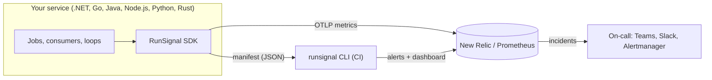

# RunSignal

[](https://github.com/gokhanertogan/RunSignal/actions/workflows/ci.yml)
[](https://www.nuget.org/packages/RunSignal.DotNet)
[](https://www.npmjs.com/package/@runsignal/node)
[](https://central.sonatype.com/namespace/io.github.gokhanertogan.runsignal)
[](https://pypi.org/project/runsignal/)
[](https://crates.io/crates/runsignal)
[](https://pkg.go.dev/github.com/gokhanertogan/RunSignal/go)
[](LICENSE)

**Cron job and background job monitoring on OpenTelemetry, with alerts as code.** Get alerted when a scheduled job
is missed, fails, runs too long or processes nothing, and when a queue consumer or worker loop stalls. One signal
model for .NET, Go, Java, Node.js, Python and Rust; alerts and dashboards for New Relic, Prometheus and Grafana.
No hosted service and no ping URLs: the alerts live in the backend you already use.

Your APM alerts on HTTP 500s and slow endpoints. The failures that hurt most often happen where there is no
HTTP request at all:

- The 02:00 invoice job never started, because the server restarted or the scheduler got stuck.
- A queue consumer is up but has not processed a message for 20 minutes.
- The bank statement file did not arrive, so the import "succeeded" with 0 rows.
- A background loop is deadlocked, and its exception was swallowed in a `catch`.

RunSignal records the **runs, items and heartbeats** of background work as OpenTelemetry metrics, with the same
names in .NET, Go, Java, Node.js, Python and Rust. From a manifest of what each job is expected to do, it
**provisions the alerts and dashboards** in your observability backend: missed, failed, overrun, hung, stalled, low
output and failure rate.

> **Status: 0.1.** Everything below works and is tested, including end to end against a live New Relic account
> and a local Prometheus. Until 1.0, minor versions may contain breaking changes. Teams and Slack routing is
> implemented but not yet verified end to end. See the [roadmap](docs/ROADMAP.md) and the
> [changelog](CHANGELOG.md).

## Installation

| Language | Package | Install |
|---|---|---|
| .NET | [`RunSignal.DotNet`](https://www.nuget.org/packages/RunSignal.DotNet) and integrations | `dotnet add package RunSignal.DotNet` |
| Go | [`github.com/gokhanertogan/RunSignal/go`](https://pkg.go.dev/github.com/gokhanertogan/RunSignal/go) | `go get github.com/gokhanertogan/RunSignal/go` |
| Java | [`io.github.gokhanertogan.runsignal`](https://central.sonatype.com/namespace/io.github.gokhanertogan.runsignal) | `runsignal-spring-boot-starter` or `runsignal`, version `0.3.0` |
| Node.js | [`@runsignal/node`](https://www.npmjs.com/package/@runsignal/node) | `npm install @runsignal/node @opentelemetry/api` |
| Python | [`runsignal`](https://pypi.org/project/runsignal/) | `pip install runsignal` |
| Rust | [`runsignal`](https://crates.io/crates/runsignal) | `cargo add runsignal` |
| CLI | [`RunSignal.Cli`](https://www.nuget.org/packages/RunSignal.Cli) | `dotnet tool install -g RunSignal.Cli` |
| CLI, without .NET | [release assets](https://github.com/gokhanertogan/RunSignal/releases) and [`ghcr.io/gokhanertogan/runsignal`](https://github.com/gokhanertogan/RunSignal/pkgs/container/runsignal) | a native executable for Linux (glibc and musl, x64 and arm64), macOS and Windows |

## Why RunSignal

| | Ping-based cron monitors (Healthchecks.io, Cronitor, Sentry Crons) | RunSignal |
|---|---|---|
| How it works | Each job pings a monitoring service | Jobs emit OpenTelemetry metrics to the backend you already use |
| Missed, failed and overrunning runs | ✅ | ✅ |
| A run that hangs and never finishes | rarely (only as a missed ping) | ✅ `hung`, while it is still hanging |
| Stalled consumers and loops | ✅ with heartbeat pings | ✅ with heartbeats |
| "Succeeded, but processed 0 rows" | rarely | ✅ `minProcessed` |
| Failure rate across many runs, by error type | rarely | ✅ |
| Where alerts are defined | the service's UI, API or SDK | generated in CI from the manifest the application writes |
| Where data and alerts live | the monitoring service | your New Relic or Prometheus |

Use RunSignal if you already run OpenTelemetry with New Relic or Prometheus and want your jobs alerted on
like your HTTP endpoints, without another SaaS and without pinging a URL from every job.

## Contents

- [Installation](#installation)
- [How it works](#how-it-works)
- [Concepts](#concepts)
- [Quick start](#quick-start)
- [Integrations](#integrations)
- [Scripts, crontab and Kubernetes CronJobs](#scripts-crontab-and-kubernetes-cronjobs)
- [GitHub Actions](#github-actions)
- [Alerts](#alerts)
- [Backends](#backends): [New Relic](#new-relic), [Prometheus and Grafana](#prometheus-and-grafana)
- [CLI](#cli)
- [Signals and specification](#signals-and-specification)
- [Performance](#performance)
- [Repository layout](#repository-layout)
- [Building and testing](#building-and-testing)

## How it works



1. **Record.** The SDK records each run of a workload (success, failure, cancellation, duration), the items
   it handled, and heartbeats from long-running loops. Integrations do this with no code for Hangfire, Quartz.NET,
   Spring `@Scheduled`, Spring Batch, BullMQ and robfig/cron.
2. **Describe.** Each workload declares what it is expected to do: its cron schedule, maximum duration,
   heartbeat interval, minimum output and acceptable failure rate. The running application writes these to a
   [manifest](spec/manifest.schema.json).
3. **Provision.** In CI, `runsignal provision` turns the manifest into alert conditions and a dashboard in New
   Relic, or `runsignal export prometheus` writes Prometheus alerting rules.

Alerts are evaluated by the backend, never in your process, because a process that has died cannot report
that it is missing.

## Concepts

| Term | Meaning |
|---|---|
| **Workload** | A unit of background work with a stable name, such as `nightly-invoice`: a scheduled job, a consumer, a sync loop. |
| **Run** | One execution of a workload. It ends as `success`, `failure` (with an `error.type`) or `cancelled`. |
| **Item** | One unit of work inside a run, such as an invoice or a message: `processed` or `failed`. |
| **Heartbeat** | A periodic "alive and making progress" mark from a long-running loop. |
| **Expectations** | What the workload should do. Each one produces an alert: |

| Expectation | Example | Alert |
|---|---|---|
| `schedule` | `0 2 * * *` | **missed**: no success within the schedule plus grace; **failed**: a run failed |
| `maxDuration` | 30 minutes | **overrun**: a run took longer; **hung**: a run has been running longer and has not finished |
| `expectEvery` | 5 minutes | **stalled**: no heartbeat in time |
| `minProcessed` | 100 | **low output**: runs processed fewer items |
| `failureRateThreshold` | 0.2 | **failure rate**: too many failed runs or items |
| `severity` | `critical` | routes the alerts (for example, critical pages on-call) |

## Quick start

Every SDK follows the same three steps. The examples declare a nightly job that must succeed every day,
finish within 30 minutes and process at least 100 invoices.

**1. Record the work.**

<details open>
<summary>.NET</summary>

```csharp
builder.Services.AddRunSignal()
    .AddWorkload("nightly-invoice", o =>
    {
        o.Schedule = "0 2 * * *";
        o.MaxDuration = TimeSpan.FromMinutes(30);
        o.MinProcessed = 100;
        o.Severity = Severity.Critical;
    });
builder.Services.AddOpenTelemetry().WithMetrics(m => m.AddRunSignalInstrumentation().AddOtlpExporter());

// In the job ([FromKeyedServices("nightly-invoice")] Workload workload):
await workload.RunAsync(async ct =>
{
    foreach (var order in await orders.GetUnbilledAsync(ct))
    {
        await invoices.CreateAsync(order, ct);
        workload.Processed();
    }
}, ct);
```

More: [docs/dotnet.md](docs/dotnet.md)
</details>

<details>
<summary>Go</summary>

```go
invoices := runsignal.Default.MustWorkload("nightly-invoice",
    runsignal.Schedule("0 2 * * *"), runsignal.MaxDuration(30*time.Minute),
    runsignal.MinProcessed(100), runsignal.WithSeverity(runsignal.Critical))

err := invoices.Run(ctx, func(ctx context.Context) error {
    for _, order := range orders {
        if err := createInvoice(ctx, order); err != nil {
            return err
        }
        invoices.Processed(ctx, 1)
    }
    return nil
})
```

More: [go/](go)
</details>

<details>
<summary>Java (Spring Boot)</summary>

```java
@Scheduled(cron = "0 0 2 * * *")
@RunSignal(value = "nightly-invoice", maxDuration = "30m", minProcessed = 100, severity = Severity.CRITICAL)
void generateInvoices() {
    // recorded automatically by runsignal-spring-boot-starter
}
```

More: [src/RunSignal.Java](src/RunSignal.Java)
</details>

<details>
<summary>Node.js</summary>

```ts
const invoices = defaultRegistry.workload('nightly-invoice', {
  schedule: '0 2 * * *', maxDuration: '30m', minProcessed: 100, severity: 'critical',
});

await invoices.run(async () => {
  for (const order of await unbilledOrders()) {
    await createInvoice(order);
    invoices.processed();
  }
});
```

More: [src/RunSignal.Node](src/RunSignal.Node)
</details>

<details>
<summary>Python</summary>

```python
invoices = default_registry.workload("nightly-invoice",
    schedule="0 2 * * *", max_duration="30m", min_processed=100, severity="critical")

with invoices.run():
    for order in unbilled_orders():
        create_invoice(order)
        invoices.processed()
```

More: [src/RunSignal.Python](src/RunSignal.Python)
</details>

<details>
<summary>Rust</summary>

```rust
let invoices = Registry::global().workload("nightly-invoice", Options::new()
    .schedule("0 2 * * *")
    .max_duration(Duration::from_secs(30 * 60))
    .min_processed(100)
    .severity(Severity::Critical))?;

invoices.run_async(async {
    for order in unbilled_orders().await? {
        create_invoice(&order).await?;
        invoices.processed(1);
    }
    Ok::<_, anyhow::Error>(())
}).await?;
```

More: [src/RunSignal.Rust](src/RunSignal.Rust)
</details>

**2. Export to your backend** over OTLP. For New Relic use **delta temporality**: with cumulative, a stopped
workload never looks stopped. Prometheus works with the default (cumulative).

**3. Provision alerts from CI.**

```bash
RUNSIGNAL_MANIFEST_PATH=runsignal.json <start your app>   # writes the manifest (see below)
export NEW_RELIC_API_KEY=NRAK-...                          # a New Relic User API key
runsignal provision runsignal.json --account-id 1234567 --region EU
```

.NET and the Spring Boot starter write the manifest by themselves once the application has started. In Go,
Node.js, Python and Rust, call `WriteManifestFromEnv` / `writeManifestFromEnv` / `write_manifest_from_env` once your
workloads are registered.

## Integrations

| Language | Monitored with no code in the jobs | Also |
|---|---|---|
| .NET | Hangfire 1.8+, Quartz.NET 3 and 4 | `BackgroundService` heartbeats, keyed DI |
| Java | Spring `@Scheduled`, Spring Batch 5 and 6 (Spring Boot 3.2+ and 4) | expectations in `application.yml` |
| Go | robfig/cron | `context` cancellation, panic handling |
| Node.js | BullMQ processors and job schedulers; node-cron, croner, cron and node-schedule through `cronJob` | `AbortSignal` cancellation |
| Python | Celery tasks and Celery beat, APScheduler 3 | `with` / `async with` runs, `@monitor` decorator |
| Rust | | sync and async runs; a dropped future is a cancelled run |

Scheduler integrations also register jobs as workloads **at startup**, with their cron schedules, so a job
that never fires still gets a `missed` alert.

## Scripts, crontab and Kubernetes CronJobs

Work with no RunSignal SDK, such as a shell script, a crontab entry or a container in a Kubernetes CronJob, can
report through `runsignal exec`. It runs the command as one run of a workload and exports it over OTLP:

```sh
OTEL_EXPORTER_OTLP_ENDPOINT=https://otlp.eu01.nr-data.net:4318 \
OTEL_EXPORTER_OTLP_PROTOCOL=http/protobuf \
OTEL_EXPORTER_OTLP_HEADERS="api-key=$NEW_RELIC_LICENSE_KEY" \
OTEL_EXPORTER_OTLP_METRICS_TEMPORALITY_PREFERENCE=delta \
runsignal exec --workload nightly-invoice --service billing -- ./export-invoices.sh --date today
```

- **Outcome:** exit code 0 is a successful run. Any other code is a failure with `error.type` `exit_code_<n>`,
  and a command that cannot start fails as `command_not_found` with code 127. SIGTERM, SIGINT, SIGQUIT and SIGHUP
  are forwarded to the command, and the run counts as cancelled.
- **Exit code:** the command's output and exit code pass through unchanged.
- **While it runs:** it reports `active_run_age`, so a run that hangs opens `hung` while it is still hanging.
- **Configuration:** the exporter takes the standard `OTEL_EXPORTER_OTLP_*` variables. `--service` defaults to
  `OTEL_SERVICE_NAME`.

Each run is its own process, so these workloads report **per run** (`"reporting": "per-run"` in the manifest).
Silence between runs is normal, so the alerts work differently:

| | Continuous (SDK in a long-running process) | Per run (`runsignal exec`) |
|---|---|---|
| `missed` | `since_success` passes the schedule plus grace | No successful run within the schedule plus grace, once a first success has been seen |
| `not reporting` | ✅ | none: silence is normal |
| `stalled` | ✅ | none: needs a long-running process |
| `failed`, `overrun`, `hung`, `low output`, failure rates | ✅ | ✅ |
| Limits | | New Relic: `missed` needs a run at least every 48 hours (loss of signal). It is armed by the first success after `provision` (new conditions take a few minutes to start evaluating). Prometheus: the alert closes four schedule gaps after the last success. |

**Getting `runsignal` into an image.** It is a native executable of about 10 MB with no .NET dependency. Copy it from
the container image:

```dockerfile
COPY --from=ghcr.io/gokhanertogan/runsignal:latest /runsignal /usr/local/bin/runsignal        # Debian, Ubuntu, RHEL
COPY --from=ghcr.io/gokhanertogan/runsignal:latest /runsignal-musl /usr/local/bin/runsignal   # Alpine
```

- **Requirements:** the glibc build needs glibc 2.28 or later (Debian 10+, Ubuntu 20.04+, RHEL 8+, Amazon Linux 2023).
- **HTTPS export:** needs OpenSSL (`libssl`) and CA certificates, which most language images include. Without
  `libssl`, `runsignal exec` warns, still runs the command and returns its exit code, but does not export.
- **Elsewhere:** download an archive from the releases.

**Kubernetes CronJobs.** Run the container's command through `runsignal exec`:

```yaml
containers:
  - name: invoice-export
    image: registry.example.com/billing/invoice-export:1.4
    command: ["runsignal", "exec", "--workload", "invoice-export", "--", "python", "export.py"]
    env:
      - { name: OTEL_SERVICE_NAME, value: billing }
      - { name: OTEL_EXPORTER_OTLP_ENDPOINT, value: "http://otel-collector.observability:4318" }
      - { name: OTEL_EXPORTER_OTLP_PROTOCOL, value: http/protobuf }
```

`runsignal` runs as PID 1 and forwards the SIGTERM Kubernetes sends at `activeDeadlineSeconds` or on deletion, so a
stopped job is recorded as cancelled. Then write the manifest from the cluster:

```sh
runsignal discover kubernetes --service billing --namespace billing -o billing.json
runsignal provision billing.json --account-id 1234567 --region EU
```

`discover kubernetes` runs `kubectl get cronjobs -o json`, or reads its output with `--input` (`-` for standard
input). It writes:
- one per-run workload per CronJob, named after it;
- the schedule (macros such as `@hourly` included);
- the time zone, from `spec.timeZone` or a `CRON_TZ=` prefix;
- `activeDeadlineSeconds` as the max duration.

Suspended CronJobs are skipped. Annotations set the rest:

| Annotation | Example |
|---|---|
| `runsignal.io/workload` | `bank-statement-import` (the name `runsignal exec --workload` uses) |
| `runsignal.io/severity` | `critical` |
| `runsignal.io/max-duration` | `45m` (overrides `activeDeadlineSeconds`) |
| `runsignal.io/min-processed` | `100` |
| `runsignal.io/failure-rate` | `0.2` |
| `runsignal.io/ignore` | `true` |

## GitHub Actions

Provision alerts on every deploy with the bundled action:

```yaml
- uses: gokhanertogan/RunSignal@main
  with:
    command: provision runsignal.json --account-id 1234567 --region EU
    new-relic-api-key: ${{ secrets.NEW_RELIC_API_KEY }}

# or, for Prometheus and Grafana:
- uses: gokhanertogan/RunSignal@main
  with:
    command: export prometheus runsignal.json -o deploy/runsignal-rules.yml
```

The action installs the `runsignal` CLI and runs `command`; any CLI command works.

**Review alert changes on pull requests.** With `pr-comment`, the action comments on the pull request:
- the alerts the change adds, removes or changes, compared with the base branch, in reader terms such as "a run
  takes longer than 30m → 45m" or "warning → critical";
- the validation findings.

It updates the same comment on every push, and the step fails when a manifest has errors:

```yaml
on: pull_request
permissions:
  contents: read
  pull-requests: write
jobs:
  alerts:
    runs-on: ubuntu-latest
    steps:
      - uses: actions/checkout@v7
      - uses: gokhanertogan/RunSignal@main
        with:
          pr-comment: runsignal.json      # manifests, separated by spaces
```

The comparison is made on the New Relic conditions, offline. Prometheus rules follow the same expectations. Pull
requests from forks get a read-only token, so they get no comment.

## Alerts

| Alert | Fires when | New Relic | Prometheus |
|---|---|---|---|
| `missed` | No success for longer than the longest gap in the schedule plus grace (`maxDuration`, or 15 minutes) | ✅ | ✅ |
| `failed` | A run failed (scheduled workloads without a failure-rate threshold) | ✅ | ✅ |
| `stalled` | No heartbeat for longer than `expectEvery` | ✅ | ✅ |
| `overrun` | A run took longer than `maxDuration` | ✅ | ✅ (rounded up to a histogram bucket) |
| `hung` | A run has been in progress for longer than `maxDuration` and has not finished | ✅ | ✅ |
| `low output` | Successful runs processed fewer than `minProcessed` items on average within an hour | ✅ | ✅ |
| `failure rate` / `item failure rate` | More than `failureRateThreshold` of runs / items failed within 15 minutes | ✅ | ✅ |
| `not reporting` | The service sent nothing for 15 minutes (it is down, or never started) | as loss of signal on `missed` / `stalled` | `RunSignalNotReporting` |

Every alert kind has fired on a live New Relic account, and every Prometheus rule is covered by
`promtool test rules`.

## Backends

### New Relic

1. **Export** over OTLP to `https://otlp.eu01.nr-data.net:4317` (US: `otlp.nr-data.net`) with an ingest
   (license) key in the `api-key` header, and **delta temporality**
   (`OTEL_EXPORTER_OTLP_METRICS_TEMPORALITY_PREFERENCE=delta`).
2. **Provision.** `runsignal provision` creates the following, and running it again changes only what changed:
   - One policy per service and severity (`RunSignal: billing-service (critical)`) with its NRQL conditions.
   - A workflow per policy, routing incidents to the notification channels you pass with `--channel critical=<channel-id>`. Create the Teams or Slack destination and channel in New Relic first; Slack destinations can only be created in the UI.
   - A dashboard, `RunSignal: billing-service`, showing runs by outcome, each workload's last success and time since its heartbeat, p95 duration, items processed, failures by error type, and the oldest unfinished run (what `hung` alerts on).
3. **Ownership.** RunSignal changes and deletes only what it created. Conditions added by hand, and the
   policies that hold them, are kept. Notification channels are never deleted.

To check that every alert reaches you before a real job fails, run the
[alert drill](samples/RunSignal.Samples.AlertDrill). It breaks one expectation per workload. On New Relic,
overrun and stalled open within about 5 minutes, hung about 3 minutes after start, the failure rates within about
30 minutes, and low output once its hour closes.

### Prometheus and Grafana

Prometheus 3 receives OTLP directly (`--web.enable-otlp-receiver`, endpoint `/api/v1/otlp/v1/metrics`). Generate
rules from the same manifests, then load them into Prometheus, Grafana Mimir or any Prometheus-compatible
ruler:

```bash
runsignal export prometheus billing.json payments.json -o runsignal-rules.yml
runsignal export grafana billing.json payments.json -o runsignal-dashboard.json
```

`export grafana` (since 0.2.0) writes a dashboard to import or provision in Grafana: runs by outcome, firing RunSignal
alerts, p95 duration, time since each workload's last success and heartbeat, items, failures by error type, and the
oldest unfinished run. It has data source, service and workload variables; without manifests it shows every service
that reports. Pass the manifests of per-run workloads (`runsignal exec`, `discover kubernetes`): their runs are
summed per run instead of with `increase()`, as the alert rules do, and their last success comes from successful runs.

- **Routing:** Alertmanager routes on the `severity` and `runsignal_alert` labels.
- **Metric names:** the rules use the names Prometheus gives OTLP metrics by default (`runsignal_workload_runs_total`; `job` is `service.name`).
- **Thresholds:** the same as for New Relic; both backends share `RunSignal.Alerting`.

## CLI

`runsignal` is a .NET tool (`src/RunSignal.Cli`). It reads manifests from any SDK.

| Command | What it does |
|---|---|
| `plan <manifests>` | Shows the alert conditions, offline. |
| `validate <manifests> [--strict]` | Checks manifests offline. Exits with 1 on errors (invalid names, duplicate workloads, unreadable schedules or time zones), or on warnings too with `--strict` (expectations a backend cannot alert on). |
| `compare <manifests> --base <old-manifest> [--markdown]` | Shows the alerts a manifest change adds, removes or changes, offline. |
| `diff <manifests> --account-id <id> [--region EU]` | Shows what `provision` would change in New Relic. |
| `provision <manifests> --account-id <id> [--channel critical=<id>] [--no-dashboard]` | Creates and updates policies, conditions, workflows and the dashboard. |
| `destroy --service <name> --account-id <id> [--dry-run]` | Removes what RunSignal created for a service. |
| `export prometheus <manifests> [-o rules.yml]` | Writes Prometheus alerting rules. |
| `export grafana [manifests] [-o dashboard.json]` | Writes a Grafana dashboard for the Prometheus metrics. |
| `exec --workload <name> [--service <name>] -- <command>` | Runs a command as one run of a workload and exports it over OTLP. |
| `discover kubernetes --service <name> [-n <ns> \| -A] [--input <file>] [-o manifest.json]` | Writes a manifest of per-run workloads from Kubernetes CronJobs. |

Common options:
- `--time-zone Europe/Istanbul` sets the time zone schedules run in (default UTC). A workload's own `timeZone` in
  the manifest takes precedence.
- `--missed-grace` and `--not-reporting-after` set the grace periods, in minutes.
- `NEW_RELIC_API_KEY` holds the User API key.

Expected errors print one line and exit with code 1. `exec` returns the command's exit code, or 2 for its own
usage errors.

## Signals and specification

Every SDK emits the same instruments on the meter `RunSignal`:

| Metric | Type | Attributes |
|---|---|---|
| `runsignal.workload.runs` | counter | `runsignal.workload`, `runsignal.outcome`, `error.type` (failures) |
| `runsignal.workload.duration` | histogram (s, buckets from 10 ms to 8 h) | `runsignal.workload`, `runsignal.outcome` |
| `runsignal.workload.items` | counter | `runsignal.workload`, `runsignal.item.result` |
| `runsignal.workload.heartbeats` | counter | `runsignal.workload` |
| `runsignal.workload.since_success` | gauge (s) | `runsignal.workload` |
| `runsignal.workload.since_heartbeat` | gauge (s) | `runsignal.workload` |
| `runsignal.workload.active_run_age` | gauge (s) | `runsignal.workload` |

The `since_*` gauges count from registration until the first success or heartbeat. A job that never runs
therefore still looks overdue, which matters because backends only notice that a signal stopped if it was seen
at least once. `active_run_age` is the age of the oldest run still in progress (0 when none is), so a run that
hangs opens the `hung` alert while it is hanging, instead of never reaching the duration histogram. Runs are
also recorded as spans.

The contract is in [spec/README.md](spec/README.md). The SDKs are held to it by the shared
[conformance vectors](spec/conformance), which every SDK's test suite runs:
- workload naming, including non-ASCII names (`e-Arşiv gönderimi` becomes `e-arsiv-gonderimi`);
- a scenario whose exact metrics (names, types, units, attributes, values and histogram bounds) every SDK must reproduce;
- a byte-for-byte identical manifest.

## Performance

Recording a run, an item or a heartbeat does not allocate on the hot path. These numbers were measured on
Apple Silicon:

| SDK | Run (start + end) | Item / heartbeat | Measured with |
|---|---|---|---|
| .NET | ~35–40 ns, 0 B | ~1–14 ns, 0 B | BenchmarkDotNet, metrics listener only |
| Rust | ~190 ns | ~50 ns | OpenTelemetry SDK attached |
| Python | ~9 µs | ~4 µs | OpenTelemetry SDK attached, no span |
| Go | ~290–360 ns, 0 allocs | ~110 ns, 0 allocs | OpenTelemetry SDK attached |
| Node.js | ~0.7 µs | ~0.2–0.3 µs | OpenTelemetry SDK attached |

The rows were measured differently (the .NET numbers exclude the SDK's aggregation), so compare within a row.
For workloads that run thousands of times per second, turn off the per-run span (`WithoutTracing()`,
`tracing: false`, `without_tracing()`, `runsignal.tracing=false`).

## Repository layout

```
spec/                    signal contract, manifest schema, conformance vectors
go/                      Go SDK (+ rscron), module github.com/gokhanertogan/RunSignal/go
src/
  RunSignal.Core …       .NET SDK and integrations (DotNet, OpenTelemetry, Hangfire, Quartz, Quartz4)
  RunSignal.Alerting     backend-neutral alert thresholds
  RunSignal.NewRelic     New Relic alert and dashboard provisioning
  RunSignal.Prometheus   Prometheus rule generation
  RunSignal.Cli          the runsignal tool
  RunSignal.Java         Java SDK (core + Spring Boot starter)
  RunSignal.Node         Node.js SDK (+ BullMQ)
  RunSignal.Python       Python SDK (+ Celery, APScheduler)
  RunSignal.Rust         Rust SDK
samples/                 .NET worker and alert drill
tests/                   .NET tests, Quartz 4 tests, Prometheus rule tests
docs/                    roadmap, .NET guide
```

## Building and testing

| Part | Requirements | Command |
|---|---|---|
| .NET | .NET 8 and 10 SDKs | `dotnet test` |
| Prometheus rules | `promtool` | `promtool test rules tests/prometheus/rules.test.yml` |
| Go | Go 1.26+ | `cd go && go test -race ./...` |
| Java | Java 17+, Maven | `cd src/RunSignal.Java && mvn install` (Spring Boot 3: `-Dspring-boot.version=3.5.16 -Dbatch=5`) |
| Node.js | Node.js 20+, `redis-server` | `cd src/RunSignal.Node && npm ci && npm test` |
| Python | Python 3.9+ | `cd src/RunSignal.Python && pip install -e ".[celery,apscheduler]" opentelemetry-sdk pytest && pytest` |
| Rust | Rust 1.75+ | `cd src/RunSignal.Rust && cargo test` |

CI runs all of them, and the Java suite runs against Spring Boot 3.2, 3.5 and 4.1.

Releases publish every package with one tag; see [docs/RELEASING.md](docs/RELEASING.md). Contributions are
welcome: see [CONTRIBUTING.md](CONTRIBUTING.md) and [SECURITY.md](SECURITY.md).

## License

MIT
